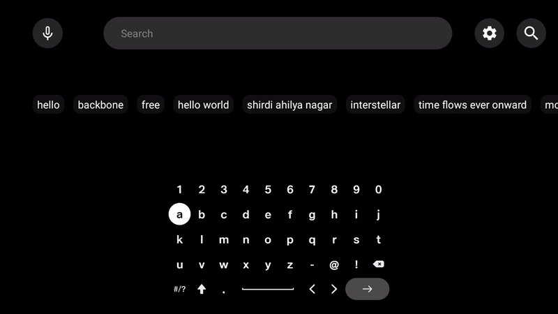
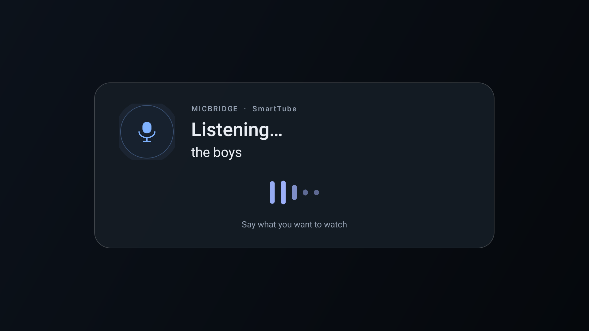
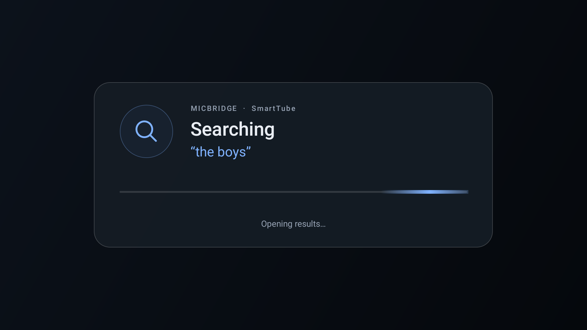
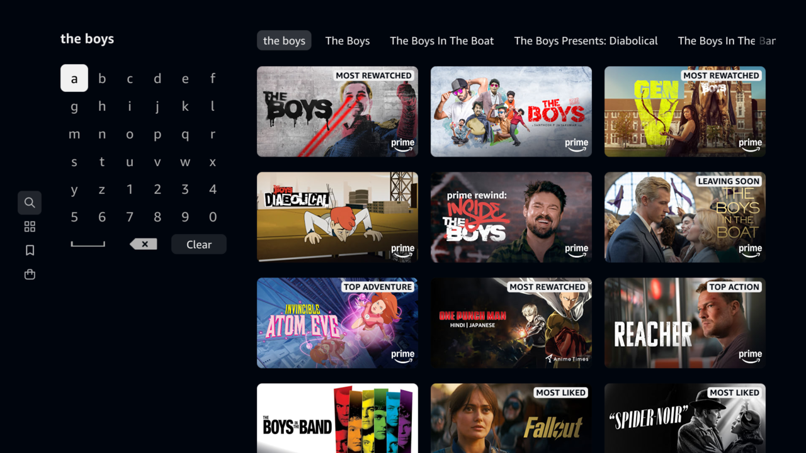
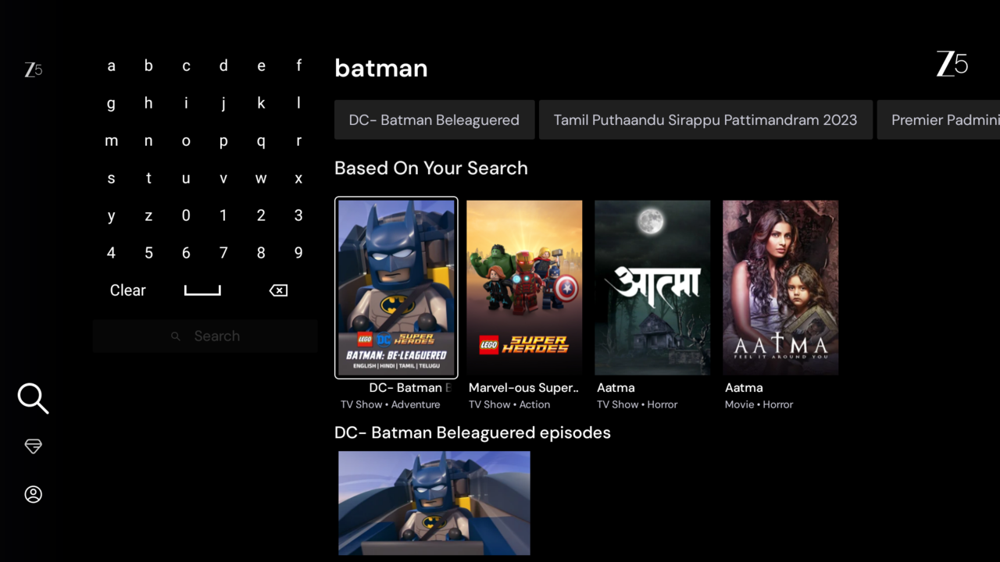
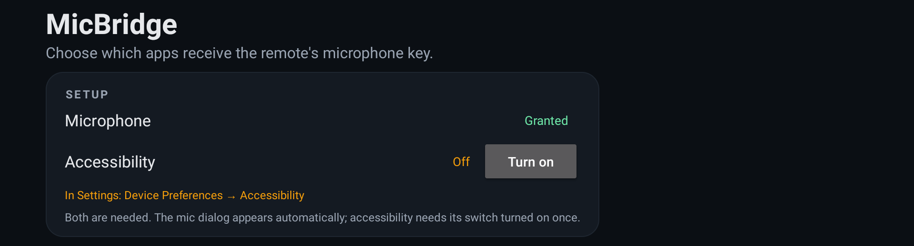

# MicBridge

**Voice input for sideloaded apps on Jio set-top boxes.**

MicBridge makes the Jio remote's microphone work in apps that Jio never whitelisted — SmartTube, Nuvio, Kodi, Jellyfin, and anything else you sideload. It needs **no root** and does not modify the system partition.

It was built and tested for the **JHSD200** (Android 11, SDK 30) running production Jio firmware, where the mic key is hard-wired to Jio's voice assistant. Not sure about other models you can try.



*Recorded on a JHSD200 with a real remote press: mic key → listening card (the stock Jio screen is covered) → searching → SmartTube results for “Hello world”.*

## Screenshots

| Listening | Searching |
| :---: | :---: |
|  |  |

The same press works in apps with very different search UIs — a Leanback text field, a Cobalt app with an almost empty accessibility tree, and an app with no search box on its home screen:

| SmartTube | Prime Video | Zee5 |
| :---: | :---: | :---: |
|  |  |  |

First launch asks for the microphone and points at the one switch Android will not let an app flip for itself:



---

## The problem

On these boxes the remote's mic button only works in Jio/preset apps:

- The mic key reports `KEYCODE_VOICE_ASSIST` (231, scan code 217) and is defined in the **system** keylayout. The firmware's `IWediaJioPodsHelper` intercepts it in `system_server` and hard-launches `com.android.app.jio.voiceassist`.
- That voice app is the **only** client the Jio speech service accepts. Starting your own `SpeechRecognizer` gets `concurrent startListening received - ignoring this call`, and the Jio app can crash.
- The keylayout and the voice component cannot be changed on a production build (`pm disable-user` returns `SecurityException: Shell cannot change component state`), and an accessibility service can observe keys but cannot consume them.
- The firmware also has **no handler** for `RecognizerIntent.ACTION_RECOGNIZE_SPEECH`, which is why in-app mic buttons (SmartTube's search orb) do nothing.

## How it works

MicBridge lets Jio do the recognition, then takes the result away from Jio:

```
remote mic press
      │
      │ firmware (unavoidable)
      ▼
com.android.app.jio.voiceassist
      │  recognised text
      ▼
:id/voiceStatesView
      │
      │  MicA11yService reads the query
      │  waits for it to stabilise / for the result banner
      ▼
GLOBAL_ACTION_BACK  ── closes the Jio overlay
      │
      ▼
foreground app receives the text via ACTION_SET_TEXT
```

Delivery is generic, in this order:

1. the focused editable field,
2. otherwise the first editable field in the window,
3. otherwise a Leanback search box: a node whose class contains `StreamingTextView`/`SearchEditText`, or whose id looks like a search field (`lb_search_text_editor`, `search_text`, `search_box`, …),
4. otherwise a search entry point — a clickable node whose text, content description or id mentions "Search". It is clicked, and delivery retries on the screen that opens. If nothing labelled is found, MicBridge falls back to the collapsed left-hand navigation rail used by apps such as Zee5 (icon-only entries with no accessible label; the top one is Search),
5. a plain `EditText` is submitted with the screen's own search button (ids such as `search_button`) or an IME action, because those fields do not search as you type,
6. otherwise a search-URL fallback: open the app's own search results with an `ACTION_VIEW` deep link (`https://www.youtube.com/results?search_query=…` for YouTube/Cobalt builds, `https://app.primevideo.com/search?phrase=…` for Prime Video, a Google search for supported browsers), or an `ACTION_SEARCH` intent,
7. otherwise it gives up quietly — nothing is typed and the app is left untouched.

Leanback apps such as SmartTube have no editable field at all: their search box is a `StreamingTextView`, so it is filled with `ACTION_SET_TEXT` directly. Browsers such as TV Bro get an extra click + focus + retry because their WebView text field often rejects the first `ACTION_SET_TEXT`. Cobalt builds such as TizenTube and Amazon Ignition (Prime Video) expose an almost empty accessibility tree, so after the field attempts fail their own link handler is used instead.

### Apps with no text field anywhere

Zee5 is the reference case: its home screen has no search box, only a collapsed rail whose Search item is an unlabelled icon. MicBridge clicks that item, waits for Zee5's search screen, types into its `EditText` and presses its own search button. Hotstar, Netflix and the other Jio presets use the same path once you turn them on in the settings screen — their stock mic button keeps working until then.

## Which apps get the mic

Routing is global by default: every app is a target **except** the following.

**Core apps — never routed.** Their keys behave exactly as stock, even if they are turned on:

- MicBridge itself and the Jio voice app,
- the current launcher, Settings, SystemUI, `android`, `com.iwedia.*` and the old Jio launchers.

**Jio presets — off by default, but you can turn them on:**

- everything under `com.jio.*`, `com.jiostb.*` and `com.jiotv.*` (JioTV+ and the rest),
- Hotstar, Netflix, Zee5, Sun NXT, Hoichoi, EPIC ON, Ultra Jhakaas and ETV Win.

They already have a working mic button on Jio's voice service, so MicBridge leaves them untouched until you ask for them.

Everything else gets the generic flow — **including apps that the Jio launcher has added to `Settings.Global remote_app_list`** (TVExplorer, Shevery, a sideloaded TizenTube, …). Version 1.0 blocked every package in that list, which silently disabled MicBridge for sideloaded apps pinned to the Jio home screen; 1.1 and later use the lists above instead.

### The settings screen

MicBridge adds a remote-friendly settings app to the launcher ("MicBridge"). It has two modes:

- **All apps** (default) — everything except the core apps and the Jio presets.
- **Only selected apps** — a pure allowlist. Switching to it seeds the list from whatever is enabled at that moment, so it does not start empty.

The list shows every launchable app with its icon. Press **OK** on a row to toggle it; changes take effect on the next mic press, with no service restart. Pressing OK on a core app explains that it is never used.

### First-run setup

The first time you open MicBridge it asks for what it needs, so no adb permission commands are required:

1. **Microphone** — the standard `RECORD_AUDIO` dialog is requested automatically. If it is denied, the setup card offers a retry, then opens the app's permission page.
2. **Accessibility** — Android does not let an app enable its own accessibility service, so this one switch must be turned on by you. The setup card opens the Android TV settings app directly (`com.android.tv.settings`), because the Jio vendor settings app has no accessibility page; on this firmware **Accessibility** is under **Device Preferences**. The card keeps the path visible while the switch is off. Return to MicBridge and the row turns green.

The card stays at the top as a status panel and can be used to reopen either setting later. After an APK update the firmware may drop the accessibility binding; opening MicBridge shows the same one-tap fix.

## Requirements

- A Jio set-top box with the Jio voice assistant (`com.android.app.jio.voiceassist`) — developed and tested on **JHSD200 / Android 11**.
- ADB access over the network (`adb connect <STB_IP>:5555`).
- **No root.**

## Install

Download `micbridge.apk` from the [latest release](https://github.com/Lucifer7535/micbridge/releases/latest), then:

```bash
adb connect <STB_IP>:5555
adb install -r micbridge.apk
```

`-r` replaces an existing copy. You can still add `-g` to grant the microphone up front, but it is not required: the first-run screen asks for it. Open **MicBridge** from the launcher after installing and follow the two setup rows.

Installing an APK kills the accessibility binding, so **the service must be enabled again after every install or update**. The app's setup card opens the right screen for you; the adb steps below are the manual equivalent.

### Enable the accessibility service manually

Normally the in-app setup card takes you here; these commands are for headless or scripted installs. Keep whatever stock services are already listed — on our JHSD200 that is `com.iwedia.ledmanager/...KeyEventMonitorService` and `com.klevico.monet/...LauncherAccessibilityService`; other boxes ship different ones. Replacing the list with only MicBridge will break the remote and launcher keys.

```bash
CUR=$(adb shell settings get secure enabled_accessibility_services | tr -d '\r')
case "$CUR" in
  *dev.dedsec.micbridge*) NEW="$CUR" ;;              # already listed
  ""|null) NEW="dev.dedsec.micbridge/.MicA11yService" ;;
  *) NEW="$CUR:dev.dedsec.micbridge/.MicA11yService" ;;
esac
# This firmware sometimes clears the list when the service is disabled, so
# write it *after* turning accessibility off and before turning it back on.
adb shell settings put secure accessibility_enabled 0
adb shell settings put secure enabled_accessibility_services "$NEW"
adb shell settings put secure accessibility_enabled 1
```

Confirm it bound:

```bash
adb shell settings get secure enabled_accessibility_services
adb logcat -s MicBridge
# I MicBridge: service connected; flags=114 home=com.klevico.monet
# I MicBridge: rules: mode=all enabled=0 disabled=0; allow= block= search=
```

The service also starts on its own after a reboot, as long as it stays in `enabled_accessibility_services`.

## Use

Press the mic key and speak. The firmware still starts the Jio assistant, but for routed apps MicBridge covers it with the listening card, shows the recognised words, then closes it and delivers the text.

- **SmartTube:** press mic anywhere, or press its own search orb.
- **TizenTube:** press mic anywhere; the app opens its search results for what you said.
- **Prime Video:** press mic on any screen; the profile picker is answered automatically (it always picks the profile Prime highlights, i.e. the last one used) and the results open.
- **Zee5, Hotstar, Netflix:** after enabling them in the MicBridge settings screen, press mic anywhere — MicBridge opens their search screen, types the query and submits it.
- **Nuvio and other apps:** open the app's search screen first if it does not expose a search entry point on the current screen.

### Injecting a query without speaking

Useful for testing or for scripted setups:

```bash
adb shell am broadcast -a dev.dedsec.micbridge.TEST --es target com.nuvio.tv --es query "hello"
```

Omit `--es target` to use the last foreground app, or omit `--es query` to capture from an already-open Jio overlay.

`adb shell` re-splits its arguments, so wrap the whole remote command for a multi-word query:

```bash
adb shell "am broadcast -a dev.dedsec.micbridge.TEST --es target com.zee5.aosp --es query 'the boys'"
```

To preview the card without speaking, add `--ez demo true`. It plays the listening → searching → fade sequence and types nothing:

```bash
adb shell "am broadcast -a dev.dedsec.micbridge.TEST --es target org.smarttube.stable --es query 'hello' --ez demo true"
```

## Debugging

```bash
adb logcat -s MicBridge
```

A working press in an app with a text field looks like this:

```text
mic key kc=231 scan=217 app=org.smarttube.stable
overlay: listening over SmartTube
voice overlay over org.smarttube.stable -> capturing
overlay: listening over SmartTube (early)
captured query: "hello"
overlay: searching "hello" in SmartTube
deliverToApp try=0 top=org.smarttube.stable target=org.smarttube.stable
typed into org.smarttube.stable (StreamingTextView#lb_search_text_editor): hello
```

The first `overlay:` line is the card raised on key-down; `(early)` marks the capture reusing that card instead of rebuilding it.

An app with no text field on its home screen (Zee5, after enabling it) goes through its search screen instead:

```text
TEST target=com.zee5.aosp query=batman blocked=false
rail: 3 icon-only entries
opening search in com.zee5.aosp via ViewGroup#collection_header_parent
ACTION_SET_TEXT ok=true
typed into com.zee5.aosp (EditText#searchQuery): batman
search submit via LinearLayout#search_button
```

If the second line says `-> blocked`, the app is excluded by the routing rules — use the MicBridge settings screen or `micbridge_allow` (see below). `overlay: listening over <label>` and `overlay: searching "<query>" in <label>` mark the animated card. If the log says `search via url in <pkg>` or `search via ACTION_SEARCH in <pkg>`, the app had no text field and its own search handler was opened. If it ends with `no text field in <pkg>` and no search line follows, the app has neither a field, a visible search entry, nor a known search URL; open its search screen first or add one with `micbridge_search`.

The same log is appended to `/sdcard/Android/data/dev.dedsec.micbridge/files/micbridge.log`.

## Build from source

`build.sh` builds the APK directly with the SDK build-tools — **no Gradle**. You need:

| Tool | Version |
| --- | --- |
| JDK | 17 |
| Android SDK build-tools | `30.0.3` |
| Android platform | `android-30` (`platforms/android-30/android.jar`) |

```bash
export JAVA_HOME=/path/to/jdk-17
export SDK=/path/to/android-sdk      # must contain build-tools/30.0.3 and platforms/android-30
./build.sh                            # -> micbridge.apk
```

Releases are built by GitHub Actions: pushing a `v*` tag (`.github/workflows/release.yml`) runs the same `build.sh` on the runner's Android SDK, checks that the tag matches the manifest's `versionName`, and publishes `micbridge.apk` as a release asset. The workflow can also be started manually with an existing tag.

The APK is signed with the bundled `micbridge.keystore` (alias `micbridge`, store/key password `android`).

> [!IMPORTANT]
> That keystore is a public, self-signed development key. It exists only so rebuilds keep the same signature and can update the installed app. Never reuse it for anything else.

### Project layout

```
app/src/main/AndroidManifest.xml
app/src/main/java/dev/dedsec/micbridge/
  MicA11yService.java     accessibility service: capture, scrape, deliver
  SearchOverlay.java      animated listening/searching card + voice bars
  Rules.java              routing model, stored selection, app list
  SettingsActivity.java   first-run setup + allowlist / mode picker
  RecognizeActivity.java  RecognizerIntent handler for in-app mic buttons
  L.java                  logger (logcat + file)
app/src/main/res/xml/a11y_config.xml
app/src/main/res/drawable-*/banner.png, ic_launcher.png
build.sh
micbridge.keystore
micbridge.apk
```

## Routing overrides from adb

The settings screen covers normal use. These `Settings.Global` keys are live overrides on top of it, handy for scripted setups or recovering a box without the UI. `micbridge_allow` always wins, then `micbridge_block`, then the stored selection.

`micbridge_allow` is a comma/space separated list of package names that always get the generic flow, even if they are Jio/preset packages. A trailing `*` matches a prefix:

```bash
# allow one app (e.g. a TizenTube APK that reuses com.jio.yt)
adb shell settings put global micbridge_allow "com.jio.yt"

# allow a whole family, plus one exact package
adb shell settings put global micbridge_allow "com.jio.*,com.example.app"
```

The setting is read live; no restart is needed. Clear it with:

```bash
adb shell settings delete global micbridge_allow
```

`micbridge_block` forces specific packages back to the stock behaviour, even if they would normally be routed (same syntax, read live):

```bash
adb shell settings put global micbridge_block "com.example.app,com.other.*"
adb shell settings delete global micbridge_block
```

`micbridge_search` adds search-URL templates for apps that expose no text field and are not recognised automatically. Entries are separated by `;` or newlines; `%s` is replaced with the URL-encoded query:

```bash
adb shell settings put global micbridge_search "com.example.app=https://example.com/search?q=%s"
adb shell settings delete global micbridge_search
```

Templates are tried after field delivery has failed. A template is only used if the app actually handles the link.

To change the built-in lists instead, edit `Rules.java`:

```java
private static final String[] CORE_EXACT = { ... };   // never routed
private static final String[] PRESET_EXACT = { ... }; // off by default, can be enabled
```

then rebuild and reinstall.

## Uninstall / rollback

```bash
CUR=$(adb shell settings get secure enabled_accessibility_services | tr -d '\r')
NEW=$(printf '%s' "$CUR" | sed 's#:dev.dedsec.micbridge/.MicA11yService##; s#dev.dedsec.micbridge/.MicA11yService:##; s#^dev.dedsec.micbridge/.MicA11yService$##')
adb shell settings put secure enabled_accessibility_services "$NEW"
adb uninstall dev.dedsec.micbridge
```

The stock mic path is untouched, so Jio apps keep working exactly as before.

## Credits

Extracted from [sideload-jiostb](https://github.com/ilikechocopies/sideload-jiostb), the ADB setup guide for Jio set-top boxes.

## License

[Apache License 2.0](LICENSE)
